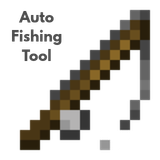

<p align="center"></p>

# AutoFishing

A Python auto-fisher for Minecraft (Java Edition). It reads Minecraft's on-screen **subtitles**, and when it sees **"Fishing Bobber splashes"** it right-clicks to reel in and right-clicks again to recast.

It only looks at your screen and sends mouse clicks. It does not modify the game or read its memory.

> **Heads up:** Some servers ban or restrict automation. Check your server's rules before using this.

## Download (no Python needed)

1. Go to the [**Releases**](../../releases/latest) page and download **AutoFishing.exe**.
2. Double-click it. The app window opens (the first launch takes a few seconds).
3. Follow [Using the GUI](#using-the-gui-recommended) below.

**"Windows protected your PC" warning?** The app isn't code-signed, so Windows SmartScreen and some antivirus programs flag new unsigned apps that read the screen and send clicks. Click **More info** then **Run anyway**. If you'd rather not trust a binary, you can [run it from source](#run-from-source) and read every line, or check the download against the `AutoFishing.exe.sha256` file on the release page:

```powershell
Get-FileHash AutoFishing.exe -Algorithm SHA256
```

Your settings (and your manual calibration, if you use it) are saved in `%APPDATA%\AutoFishing`. Delete that folder to reset the app.

## Requirements

- Windows 10/11 (the `keyboard` library and screen capture are set up for Windows)
- Minecraft Java Edition running **windowed** or **borderless fullscreen** (exclusive fullscreen can't be captured)
- Python 3.10 or newer, only if you run from source

## Run from source

1. **Get the code**

   ```bash
   git clone https://github.com/Sihathun/mcAutoFishing.git
   cd mcAutoFishing
   ```

2. **(Optional) Create a virtual environment**

   ```bash
   python -m venv .venv
   .venv\Scripts\activate
   ```

3. **Install dependencies**

   ```bash
   pip install -r requirements.txt
   ```

4. **Turn on subtitles in Minecraft**

   `Options` → `Accessibility Settings` → `Show Subtitles: ON`

   The subtitle box appears in the bottom-right corner by default.

## Using the GUI (recommended)

```bash
python gui.py
```

You can also double-click `start_gui.bat`.

1. **Turn on subtitles** in Minecraft: Options > Accessibility Settings > Show Subtitles.
2. **Check the game window.** The app finds Minecraft by itself and shows a green tick with the window it chose. If it picked the wrong program (or found none), open the **Game window** dropdown, which lists every open window, and pick the right one. **↻** refreshes the list.
3. **Test detection** (optional): watches the subtitles and reports splashes **without clicking**. The live view shows what the bot sees and the match bar shows how close it is to triggering.
4. **Start** (or **F6**), cast your rod, and switch to Minecraft. You have a few seconds (the *Start delay* setting).

There is **nothing to calibrate**. The first time a fish bites, the app learns your in-game GUI size from the "Fishing Bobber splashes" subtitle, reels that fish in, and remembers the size for next time. It re-learns by itself if you resize the window or change the GUI scale.

Automatic setup understands the **English** text in the **default Minecraft font**. For other languages or a resource pack that changes the font, switch to **Manual calibration** (below the dropdown): click **Calibrate (F9)**, switch to Minecraft, cast your rod, and press **F9** the moment "Fishing Bobber splashes" shows in the subtitles, then drag a box around the **whole subtitle area** and a **tight box around just the text**. No game screenshot handy? **From screenshot...** lets you calibrate from a saved image of your whole desktop.

| Key | Action |
| --- | --- |
| **F6** | Start |
| **F7** | Pause / resume |
| **F8** | Stop |
| **F9** | Capture the screen while calibrating |
| Mouse into a screen corner | Emergency abort (PyAutoGUI failsafe) |

The hotkeys work even while Minecraft has focus. All settings are editable in the app (hover a setting for an explanation) and are saved automatically.

**Dark mode:** click the **⚙** gear in the top-right corner and pick **Appearance**: *Match Windows* (default), *Light* or *Dark*.

**Safety net:** by default the bot only clicks while the game window it is watching is the focused window. If you alt-tab away, it pauses clicking instead of right-clicking in another program. You can turn this off in the Settings box.

The game window needs to be visible on screen (not covered by other windows or minimized), because the app reads what is drawn on your screen.

## Command line (alternative)

```bash
python autofish.py run
```

The command line uses automatic setup too, so there is nothing to calibrate. Hotkeys are **F7** (pause/resume) and **F8** (quit); `--debug` prints the live match score.

### Manual calibration (only if automatic setup doesn't work)

Manual calibration teaches the script where the subtitles are on your screen and what the splash line looks like. It switches the app to manual mode.

```bash
python autofish.py calibrate
```

1. Switch to Minecraft, hold a fishing rod and cast it.
2. When a fish bites and **"Fishing Bobber splashes"** shows in the subtitles, press **F9**. Subtitles fade after about 3 seconds, so be quick.
3. A window shows a screenshot of all your monitors. Drag a box around the **whole subtitle area** and press **Enter**.
4. A second window shows just that area. Drag a **tight box around only the "Fishing Bobber splashes" text** and press **Enter**.

The script prints a self-match score, which should be about `1.00`. It saves `config.json` and `template.png` next to the script.

You can also calibrate from an existing screenshot of your whole desktop: `python autofish.py calibrate --image screenshot.png`.

**Re-calibrate** (manual mode only) if you change resolution, GUI scale or subtitle position, or if you move the Minecraft window. To go back to automatic setup, set `"mode": "auto"` in `config.json` (or pick **Automatic** in the GUI).

## Configuration

`config.json` is created by calibration and saved by the GUI. You can edit it by hand too:

| Setting | Default | Meaning |
| --- | --- | --- |
| `match_threshold` | `0.80` | How closely the screen must match the splash line (0 to 1). Lower it if bites are missed, raise it if you get false triggers. |
| `reel_delay` | `0.15` | Seconds between detecting the splash and reeling in |
| `recast_delay` | `1.0` | Seconds between reeling in and recasting |
| `cooldown` | `4.0` | Seconds to ignore the screen after a catch, so the lingering subtitle doesn't trigger twice |
| `poll_interval` | `0.05` | Seconds between screen checks |
| `start_delay` | `5` | Seconds to switch to Minecraft after pressing Start |
| `require_focus` | `true` | Only click while the game window is the focused window |
| `mode` | `"auto"` | `"auto"` = find the game window and GUI size automatically, `"manual"` = use your own calibration |
| `target_window` | `null` | The window you picked from the dropdown (`exe`, `cls`, `title`), remembered between runs. `null` = auto-detect Minecraft |
| `gui_scale` / `gui_scale_client` | `null` | The GUI scale learned in auto mode and the game window size it was learned at |
| `window_title` | `"Minecraft"` | Manual mode only: text the focused window's title must contain |
| `monitor` | `0` | Manual mode only: capture target. `0` means all monitors combined. |

## Troubleshooting

- **"No Minecraft window found":** start the game first, then press **↻**. If the game is running but still isn't found, pick its window from the dropdown. Automatic detection looks for a Java process (`javaw.exe`) with a Minecraft window.
- **Stuck on "Learning your GUI size":** it needs one real bite to learn from. Make sure subtitles are on, the game window is fully visible, and the language is English with the default font. Use **Test detection** and watch the match bar when a splash appears: it should jump above 0.85. If it doesn't, use Manual calibration instead.
- **Never triggers (manual mode):** use **Test detection** (or `run --debug`) and watch the match bar when a splash appears. If it stays below the threshold, re-calibrate with a tighter box on the text or lower the match threshold.
- **Log says "Splash seen but not clicking: the focused window is ...":** the focus safety net is blocking clicks because the game window isn't focused. Click into the game, or untick the option in Settings.
- **Calibration screenshot isn't Minecraft (manual mode):** check `calibration_screenshot.png`. Make sure the game window is visible and not in exclusive fullscreen.
- **Triggers at random:** raise `match_threshold` (for example `0.9`).
- **Clicks don't register in the game:** make sure the Minecraft window is focused and the mouse is captured (in-game, not in a menu).
- **Hotkeys don't work:** try running the terminal as administrator.

## How it works

1. **Find the game:** the Win32 window list is searched for a Minecraft window (a Java process with a known game window class or "Minecraft" in the title). You can override this from the dropdown.
2. **Capture:** `mss` grabs only the bottom-right part of that window, where subtitles are drawn.
3. **Match:** Minecraft draws its whole GUI at an integer scale N, so a subtitle is the 1x text with every pixel enlarged to an N x N block. The captured area is shrunk by each candidate N and compared with a tiny built-in picture of "Fishing Bobber splashes" using OpenCV template matching (`TM_CCOEFF_NORMED` on grayscale, which ignores brightness, so faded text still matches). The N that scores about 0.99 is your real GUI scale (wrong ones score below about 0.5), so no calibration is needed.
4. **Click:** on a match, `pyautogui` right-clicks to reel in and right-clicks again to recast, then waits out the cooldown.

In manual mode, step 3 compares against the template you calibrated, in the screen area you drew.

## Building the .exe and publishing a release (maintainers)

The exe is built with [PyInstaller](https://pyinstaller.org) from `AutoFishing.spec`.

**Build locally**

```bash
build_exe.bat
```

This creates an isolated `.venv-build`, installs `requirements-build.txt`, and writes `dist\AutoFishing.exe`. Check it with `dist\AutoFishing.exe --selftest` (exit code 0 means capture, matching, Tk rendering and keyboard hooks all work inside the bundle).

**Publish a release (automatic)**

1. In [CHANGELOG.md](CHANGELOG.md), rename `## [Unreleased]` to `## [1.1.0] - YYYY-MM-DD` (and add a fresh empty `## [Unreleased]` above it). This section becomes the release notes, so write it for users.
2. Set `__version__ = "1.1.0"` in `autofish.py` and commit both files.
3. Tag and push:

   ```bash
   git tag v1.1.0
   git push origin main --tags
   ```

4. The [Build and release](.github/workflows/release.yml) workflow builds the exe on a Windows runner, runs the self-test, and creates a GitHub Release with `AutoFishing.exe` and a SHA-256 checksum attached. The release notes are the matching `CHANGELOG.md` section. The workflow fails early if the tag doesn't match `__version__` or the changelog has no entry for that version.

**Pre-releases:** use a version with a hyphen, for example `1.1.0-beta.1` (set `__version__ = "1.1.0-beta.1"`, add a `## [1.1.0-beta.1] - YYYY-MM-DD` changelog section, tag `v1.1.0-beta.1`). The workflow publishes it as a GitHub **pre-release**: it is not marked "Latest", so the `releases/latest` download link keeps pointing at the last stable version.

The workflow also runs the unit tests (`python -m unittest discover -s tests`) before building; run them locally before tagging.

You can also run the workflow by hand from the **Actions** tab to get the exe as a build artifact without making a release.

**Changing the logo/icon:** replace `assets/logo_source.png`, run `python tools/make_icon.py` (it keeps only the largest shape, the rod, and drops the lettering, which is unreadable at small sizes), then rebuild.

When run as an exe, the app stores its data in `%APPDATA%\AutoFishing` instead of next to the script, because a one-file exe unpacks to a temporary folder that is deleted on exit.

## Files

- `gui.py`: the graphical app (game window picker, live view, settings, manual calibration wizard, start/stop)
- `start_gui.bat`: double-click launcher for the GUI when running from source
- `autofish.py`: core logic (screen capture, the fishing bot, manual calibration) plus the command-line interface
- `autodetect.py`: automatic setup: the built-in splash reference and GUI-scale detection
- `winutil.py`: Windows helpers: list open windows, find Minecraft, read a window's client area
- `theme.py`: light and dark appearance (palettes, system theme detection, dark title bar)
- `assets/`: the logo (`logo_source.png`) and the `.exe` icon (`AutoFishing.ico`); `appicon.py` is the same icon embedded for the window/taskbar icon
- `tools/make_icon.py`: regenerates `AutoFishing.ico` and `appicon.py` from `assets/logo_source.png`
- `tests/`: unit tests (`python -m unittest discover -s tests`), no game needed
- `tools/make_reference.py`: developer tool that regenerates the built-in reference from a manual calibration
- `requirements.txt`: Python dependencies for running from source
- `requirements-build.txt`, `AutoFishing.spec`, `build_exe.bat`: build the standalone `.exe`
- `.github/workflows/release.yml`: builds and publishes the exe when a `v*` tag is pushed
- `CHANGELOG.md`: what changed in each version; also used as the GitHub Release notes
- `config.json`, `template.png`, `calibration_screenshot.png`: generated per machine and git-ignored
# mcAutoFishing
